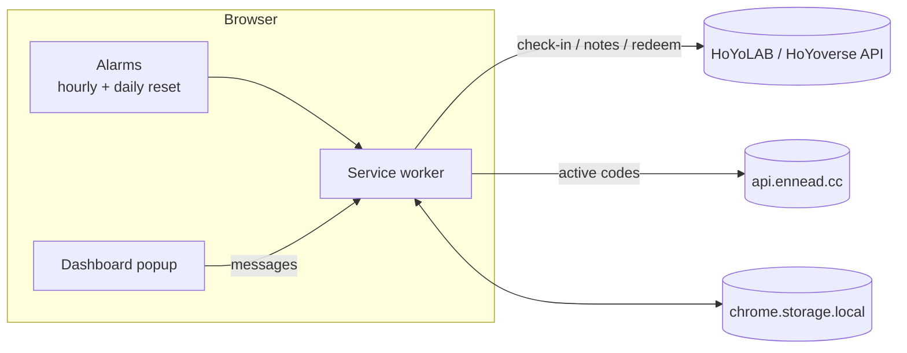

<h1 align="center">HoYoLAB Daily Auto Check-in</h1>

  A browser extension that automatically claims your <b>HoYoLAB daily check-in</b> rewards and <b>redeems gift codes</b> 
  for HoYoverse games — plus a dashboard with your <b>resin</b>, <b>daily tasks</b> and <b>Realm Currency</b>.

  
  
  
  
  

  <a href="#installation"><b>Installation</b></a> ·
  <a href="#how-it-works"><b>How it works</b></a> ·
  <a href="#troubleshooting"><b>Troubleshooting</b></a>

---

## Table of Contents

- [Details](#details)
  - [Features](#features)
  - [Supported games](#supported-games)
  - [Extension or userscripts?](#extension-or-userscripts)
- [Installation](#installation)
  - [Requirements](#requirements)
  - [Install the extension](#install-the-extension)
  - [Install the userscripts](#install-the-userscripts)
- [Usage](#usage)
  - [Dashboard](#dashboard)
  - [Settings](#settings)
- [How it works](#how-it-works)
- [Updating & uninstalling](#updating--uninstalling)
- [Troubleshooting](#troubleshooting)
- [FAQ](#faq)
- [Privacy & security](#privacy--security)
- [Support](#support)
- [Disclaimer](#disclaimer)
- [License](#license)

---

## Details

### Features

- **Automatic daily check-in** — claims the HoYoLAB login reward for every enabled game shortly after the daily reset, without opening any page.
- **Automatic gift code redemption** — fetches the list of active public codes and redeems the new ones for you.
- **Dashboard** — one click on the toolbar icon shows, for each game:
  - check-in status and today's reward,
  - energy (Original Resin / Trailblaze Power / Battery Charge) with the time until it is full,
  - daily task progress (Commissions / Daily Training / Daily Engagement),
  - Serenitea Pot **Realm Currency** (Genshin Impact),
  - recently redeemed codes.
- **Per-game settings** — disable the games you don't play; disabled games are hidden and never contacted.
- **No notifications by default** — the dashboard is read-only. Optional desktop notifications only when a check-in needs your attention.
- **Uses your browser session** — just stay logged in to HoYoLAB. No passwords, no copying cookies by hand.
- **English and Spanish** interface.

### Supported games

| Game | Daily check-in | Dashboard (energy & dailies) | Realm Currency | Code redemption |
|---|:-:|:-:|:-:|:-:|
| Genshin Impact | ✅ | ✅ | ✅ | ✅ |
| Honkai: Star Rail | ✅ | ✅ | — | ✅ |
| Zenless Zone Zero | ✅ | ✅ | — | ✅ |
| Honkai Impact 3rd | ✅ | — | — | — |
| Tears of Themis | ✅ | — | — | — |

> [!NOTE]
> Only **HoYoLAB Global** accounts are supported (America, Europe, Asia and TW/HK/MO servers). Chinese servers (miHoYo / 米游社) use a different platform.

### Extension or userscripts?

This repository contains two independent tools. Use **one** of them, not both.

| | **Browser extension** (recommended) | **Userscripts** (lightweight) |
|---|---|---|
| Games | All 5 | Genshin Impact, Honkai: Star Rail |
| Daily check-in | ✅ | ✅ |
| Code redemption | ✅ | — |
| Dashboard | ✅ | — |
| Runs without opening a website | ✅ | — (needs any web page to be opened) |
| Browsers | Chrome, Brave, Edge and other Chromium browsers | Any browser with Violentmonkey / Tampermonkey, including Firefox |
| Auto-updates | Manual (see [Updating](#updating--uninstalling)) | ✅ |

---

## Installation

### Requirements

| Requirement | Extension | Userscripts |
|---|:-:|:-:|
| A desktop **Chromium** browser 116+ (Chrome, Brave, Edge, Opera, Vivaldi) | ✅ | — |
| Any desktop browser (Chromium or Firefox) | — | ✅ |
| A userscript manager: [Violentmonkey](https://violentmonkey.github.io/) (recommended) or [Tampermonkey](https://www.tampermonkey.net/) | — | ✅ |
| Logged in to [hoyolab.com](https://www.hoyolab.com) in the same browser | ✅ | ✅ |
| **Real-Time Notes** enabled in HoYoLAB (only for the dashboard) | ✅ | — |

<b>How to enable Real-Time Notes</b>

1. Open [HoYoLAB](https://www.hoyolab.com) → your profile → **Battle Chronicle**.
2. Click the **Settings** (gear) icon.
3. Enable **Real-Time Notes** (and, if present, *Show your Battle Chronicle on your profile*) for each game.

Without this, check-in and code redemption still work, but the dashboard cannot read your resin or dailies.

---

### Install the extension

The extension is not on the Chrome Web Store yet, so it is installed as an *unpacked extension* (takes one minute):

1. **Download** this repository: green **Code** button → **Download ZIP**, then extract it.
2. Open your browser's extensions page:
   `chrome://extensions` · `brave://extensions` · `edge://extensions`
3. Enable **Developer mode** (toggle in the top-right corner).
4. Click **Load unpacked** and select the **`extension`** folder inside the extracted repository.
5. The settings page opens automatically. Check that your characters are detected and disable the games you don't play.
6. *(Optional)* Pin the extension: puzzle-piece icon in the toolbar → pin **HoYoLAB Daily Auto Check-in**.

> [!IMPORTANT]
> Do not delete or move the extracted folder: the browser loads the extension from it.

> [!TIP]
> If you were using the userscripts, uninstall them from Violentmonkey / Tampermonkey to avoid checking in twice.

---

### Install the userscripts

<b>Show userscript installation</b>

#### 1. Install a userscript manager

| Extension | Chrome / Brave / Edge | Firefox |
|---|---|---|
| **Violentmonkey** (recommended) | [Chrome Web Store](https://chromewebstore.google.com/detail/violentmonkey/jinjaccalgkegednnccohejagnlnfdag) | [Firefox Add-ons](https://addons.mozilla.org/firefox/addon/violentmonkey/) |
| Tampermonkey | [Chrome Web Store](https://chromewebstore.google.com/detail/tampermonkey/dhdgffkkebhmkfjojejmpbldmpobfkfo) | [Firefox Add-ons](https://addons.mozilla.org/firefox/addon/tampermonkey/) |

#### 2. Allow user scripts (Chromium browsers only)

Open `chrome://extensions` (or `brave://` / `edge://`) → **Details** on the userscript manager → enable **Allow User Scripts**. On older browser versions enable **Developer mode** instead.

#### 3. Install the scripts

| Game | One-click install |
|---|---|
| Genshin Impact | [**Install `genshin-checkin.user.js`**](https://raw.githubusercontent.com/JasdanJC/hoyolab-daily-auto-checkin/main/genshin-checkin.user.js) |
| Honkai: Star Rail | [**Install `starrail-checkin.user.js`**](https://raw.githubusercontent.com/JasdanJC/hoyolab-daily-auto-checkin/main/starrail-checkin.user.js) |

If the install prompt does not open: create a new script in the manager, press `Ctrl+A` to **delete the template**, paste the script and save. (Pasting over the template causes the error *"`@grant none` disables all other `@grant` keys"*.)

#### 4. Usage

The script checks in automatically the first time you open any website each day. From the manager's menu you can run **Check in now** or **Open check-in page**. Optional settings (`NOTIFY_ON_SUCCESS`, `LANG`, …) are constants at the top of each script.

---

## Usage

### Dashboard

Click the extension icon in the toolbar:

<i>One card per enabled game</i>

| Section | What it shows |
|---|---|
| **Header** | Nickname, UID and level of the character linked to your HoYoLAB account. |
| **Check-in** | ✓ checked in · … pending · ! captcha / login needed. Day of the month and today's reward. |
| **Energy** | Current / max, time until full and the exact time it fills up. Star Rail also shows Reserved Trailblaze Power. The value keeps updating while the popup is open. |
| **Dailies** | Daily task progress. Genshin also shows whether the Commission bonus has been claimed. |
| **Realm Currency** | Serenitea Pot coins and time until the storage is full (Genshin only). |
| **Gift codes** | Number of codes redeemed and the last check. Click to see the most recent ones. |

Buttons:

| Button | Action |
|---|---|
| ⟳ | Reload the dashboard data from HoYoLAB. |
| ⚙ | Open the settings page. |
| **Check in now** | Run the check-in immediately for all enabled games. |
| **Redeem codes now** | Look for new codes and redeem them immediately. |

The badge on the icon shows **`!`** when you are not logged in, or a number when some check-ins need attention.

### Settings

Right-click the icon → **Options**, or ⚙ in the dashboard.

| Setting | Description |
|---|---|
| **Account** | Shows the logged-in HoYoLAB ID. *Reload linked characters* refreshes the detected characters (e.g. after starting a new game). |
| **Games** | Per game: **Enabled** (master switch), **Daily check-in** and **Auto-redeem codes**. |
| **Desktop notifications** | Off by default. When on, you get a notification only if a check-in needs a captcha, a login or fails. |
| **Language of HoYoLAB texts** | Language of reward names and server messages. The interface follows your browser language (English / Spanish). |
| **Clear stored data** | Deletes check-in history, dashboard cache and the list of redeemed codes. |

---

## How it works

### Schedule

| Task | When |
|---|---|
| Daily check-in | 2–12 min after the daily reset (**00:00 UTC+8**), on browser start, and every hour as a fallback until it succeeds. Already-claimed games are skipped. |
| Code redemption | Every 3 hours. Each code is tried once per game; HoYoverse requires ~5 s between redemptions, so the extension waits 6 s between them. |
| Dashboard data | Only when you open the popup (cached for 5 minutes). It is never fetched in the background. |

### Technical details

| Topic | Behavior |
|---|---|
| **Platform** | Manifest V3 extension. Background work runs in a service worker woken up by `chrome.alarms`, so nothing has to stay open. |
| **Session** | The HoYoLAB cookies are read on demand with `chrome.cookies` and attached **only to the extension's own requests** to `hoyolab.com` / `hoyoverse.com` through a temporary `declarativeNetRequest` session rule that is removed right after each task. This makes it work in browsers that block cookies in background requests (e.g. Brave) and for code redemption on `hoyoverse.com`. Cookie values are never written to storage. |
| **Characters** | Linked characters (UID, server, level) are read from the HoYoLAB game record card and cached for 12 hours. |
| **Dashboard** | Uses the Battle Chronicle *Real-Time Notes* endpoints, signed with the same `DS` header the HoYoLAB website uses. Read-only. |
| **Captcha** | If HoYoLAB asks for a captcha, the extension stops and marks the game; it never tries to solve or bypass it. |
| **Codes** | Active codes come from the community API [api.ennead.cc](https://api.ennead.cc) (the same source used by other open-source HoYoLAB tools). No personal data is sent to it. |
| **Storage** | `chrome.storage.local`: settings, check-in results, dashboard cache and redeemed code list. Clearable from Settings. |

### API endpoints

| Game | Check-in API | `act_id` | Real-Time Notes | Code redemption |
|---|---|---|---|---|
| Genshin Impact | `sg-hk4e-api.hoyolab.com/event/sol` | `e202102251931481` | `bbs-api-os.hoyolab.com/game_record/genshin/api/dailyNote` | `sg-hk4e-api.hoyoverse.com` |
| Honkai: Star Rail | `sg-public-api.hoyolab.com/event/luna/os` | `e202303301540311` | `bbs-api-os.hoyolab.com/game_record/hkrpg/api/note` | `sg-hkrpg-api.hoyoverse.com` |
| Zenless Zone Zero | `sg-public-api.hoyolab.com/event/luna/zzz/os` | `e202406031448091` | `sg-act-nap-api.hoyolab.com/event/game_record_zzz/api/zzz/note` | `public-operation-nap.hoyoverse.com` |
| Honkai Impact 3rd | `sg-public-api.hoyolab.com/event/mani` | `e202110291205111` | — | — |
| Tears of Themis | `sg-public-api.hoyolab.com/event/luna/os` | `e202202281857121` | — | — |

### Limitations

- The browser must be running. If it is closed all day, that day's check-in is missed.
- HoYoverse can change its APIs or request signatures at any time; the dashboard or code redemption may stop working until the extension is updated.
- One HoYoLAB account at a time (the one logged in to the browser).

---

## Updating & uninstalling

**Extension**
- **Update:** download the new version of the repository, replace the contents of your extracted folder, then click the ↻ (*Reload*) button on the extension's card in `chrome://extensions`. Settings and history are kept.
- **Uninstall:** `chrome://extensions` → **Remove** on the extension's card, then delete the folder.

**Userscripts**
- Updates are automatic. To uninstall: userscript manager dashboard → select the script → **Delete**.

---

## Troubleshooting

| Symptom | Cause | Fix |
|---|---|---|
| Red **`!`** badge / *"You are not logged in to HoYoLAB"* | No HoYoLAB session in this browser, or it expired. | Log in at [hoyolab.com](https://www.hoyolab.com), then press ⟳ in the dashboard. |
| *"Real-Time Notes are disabled"* | Battle Chronicle privacy settings. | [Enable Real-Time Notes](#requirements). |
| *"No character on this account"* | No character of that game linked to your HoYoLAB account. | Link it in HoYoLAB, or disable the game in Settings. Then use *Reload linked characters*. |
| *"Captcha required"* | HoYoLAB anti-bot check. | Click **Check in now** on that card and complete it manually. Happens occasionally. |
| *"Code redemption needs a fresh login"* | The browser session has no code-redemption token. | Log out of hoyolab.com and log in again. |
| Codes not redeemed for one game | Character level too low, code limit reached or expired codes. | Expected — these codes are marked and not retried. |
| Extension disappeared after moving the folder | Unpacked extensions are loaded from their folder. | Load it again with **Load unpacked**. |
| Userscript crossed out with a red **ⓘ** in Violentmonkey | User scripts not allowed (Chromium MV3). | Enable **Allow User Scripts** in the manager's details page. |

---

## FAQ

<b>Can I get banned for using this?</b>

The extension never touches the game client. Check-in and the dashboard send the same requests as the HoYoLAB website. Automating the HoYoLAB check-in has been common practice for years with no known bans. Code redemption is slightly more automated, but it uses the official web redemption page's API with the required delays. HoYoverse's Terms of Service broadly prohibit unauthorized automation, so **use it at your own risk**.

<b>Does it work if the browser is closed?</b>

No. Extensions only run while the browser is running (it can be minimized, and no tab needs to be open).

<b>Why does it need the "cookies" permission?</b>

To attach your existing HoYoLAB session to the extension's own API requests. Cookies are read on demand, used only for requests to `hoyolab.com` / `hoyoverse.com`, and never stored or sent anywhere else. See [Privacy & security](#privacy--security).

<b>Will it support Firefox or the Chrome Web Store?</b>

Both are planned. Meanwhile, Firefox users can use the [userscripts](#install-the-userscripts).

<b>Can I use several HoYoLAB accounts?</b>

Not yet — it uses the account logged in to the browser. Multi-account support is planned.

---

## Privacy & security

- **Your session stays in your browser.** HoYoLAB cookies are only attached to requests sent to HoYoLAB / HoYoverse servers. They are never saved by the extension and never sent to any other server.
- **The only third-party service** is [api.ennead.cc](https://api.ennead.cc), queried anonymously for the list of public codes.
- **No analytics, no tracking, no remote code.** Everything the extension runs is in this repository.
- **Permissions used:** `alarms` (scheduling), `storage` (settings and history), `cookies` (session), `declarativeNetRequestWithHostAccess` (attaching the session to its own requests), `notifications` (optional alerts), and host access to `*.hoyolab.com`, `*.hoyoverse.com` and `api.ennead.cc`.
- The code is short and readable — feel free to review it before installing.

---

## Support

These tools are free and open source. If they saved you a few clicks (or a missed login reward), you can support their development with a coffee:

  

Bug reports, ideas and pull requests are also very welcome in [Issues](https://github.com/JasdanJC/hoyolab-daily-auto-checkin/issues). A ⭐ on the repository helps too!

---

## Disclaimer

This project is **not affiliated with, endorsed by, or sponsored by** HoYoverse, COGNOSPHERE or miHoYo. *Genshin Impact*, *Honkai: Star Rail*, *Zenless Zone Zero*, *Honkai Impact 3rd*, *Tears of Themis* and *HoYoLAB* are trademarks of their respective owners.

This software is provided "as is", without warranty of any kind. You are responsible for complying with HoYoverse's Terms of Service.

---

## License

Distributed under the [MIT License](LICENSE). © 2026 JasdanJC
