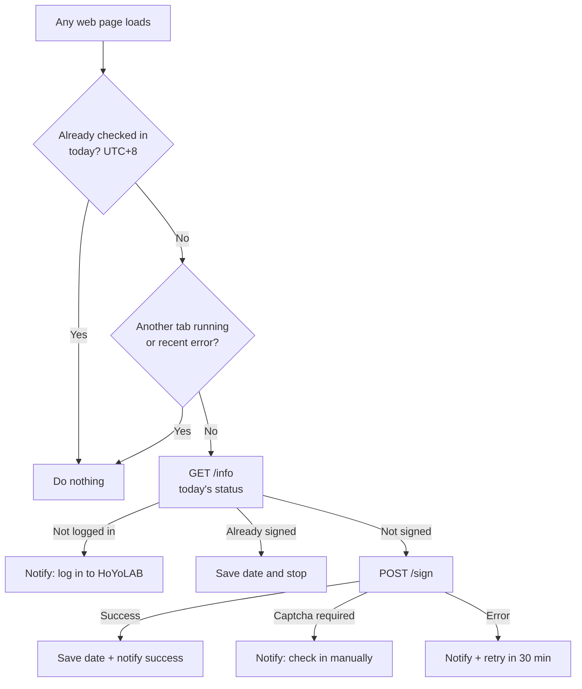

<h1 align="center">HoYoLAB Daily Auto Check-in</h1>

  Lightweight userscripts that automatically claim your <b>HoYoLAB daily check-in</b> rewards 
  for <b>Genshin Impact</b> and <b>Honkai: Star Rail</b> — in the background, while you browse.

  
  
  
  

  <a href="#installation"><b>Installation</b></a> ·
  <a href="#how-it-works"><b>How it works</b></a> ·
  <a href="#troubleshooting"><b>Troubleshooting</b></a>

---

## Table of Contents

- [Details](#details)
  - [Features](#features)
  - [Supported games](#supported-games)
- [Installation](#installation)
  - [Requirements](#requirements)
  - [Quick install](#quick-install)
  - [Manual install](#manual-install)
  - [Verify the installation](#verify-the-installation)
- [Usage](#usage)
- [How it works](#how-it-works)
- [Configuration](#configuration)
- [Updating & uninstalling](#updating--uninstalling)
- [Troubleshooting](#troubleshooting)
- [FAQ](#faq)
- [Privacy & security](#privacy--security)
- [Disclaimer](#disclaimer)
- [License](#license)

---

## Details

### Features

- **Fully automatic** — claims the daily reward once per day without you having to visit HoYoLAB.
- **Runs on any website** — opening any normal web page is enough to trigger the check-in.
- **Server-time aware** — uses HoYoLAB's reset time (00:00 UTC+8), not your local clock.
- **Desktop notifications** — on success, on errors, and when manual action is needed.
- **Safe by design** — reuses your existing browser session; never asks for or stores passwords, cookies or tokens.
- **Rate-limited** — one request cycle per day, a cross-tab lock and a back-off after errors.
- **Captcha-friendly** — never tries to bypass verification; it notifies you instead.
- **Auto-updates** through your userscript manager.

### Supported games

| Game | Script | Region | Install |
|---|---|---|---|
| Genshin Impact | [`genshin-checkin.user.js`](genshin-checkin.user.js) | HoYoLAB Global | [➜ Installation](#installation) |
| Honkai: Star Rail | [`starrail-checkin.user.js`](starrail-checkin.user.js) | HoYoLAB Global | [➜ Installation](#installation) |

Each script is independent: install only the one(s) for the games you play.

> [!NOTE]
> Only **HoYoLAB Global** accounts are supported (America, Europe, Asia and TW/HK/MO servers). Chinese servers (miHoYo / 米游社) use a different platform and are **not** supported.

---

## Installation

### Requirements

#### 1. A desktop browser

| Browser engine | Examples |
|---|---|
| **Chromium** | Google Chrome, Brave, Microsoft Edge, Opera, Vivaldi |
| **Gecko** | Mozilla Firefox |

Mobile browsers are not supported.

#### 2. A userscript manager extension

A userscript manager is a browser extension that runs small scripts (*userscripts*) on web pages.

| Extension | Chrome / Brave / Edge | Firefox | Notes |
|---|---|---|---|
| **Violentmonkey** | [Chrome Web Store](https://chromewebstore.google.com/detail/violentmonkey/jinjaccalgkegednnccohejagnlnfdag) | [Firefox Add-ons](https://addons.mozilla.org/firefox/addon/violentmonkey/) | **Recommended.** Free and open source. |
| Tampermonkey | [Chrome Web Store](https://chromewebstore.google.com/detail/tampermonkey/dhdgffkkebhmkfjojejmpbldmpobfkfo) | [Firefox Add-ons](https://addons.mozilla.org/firefox/addon/tampermonkey/) | Also supported. |

#### 3. Allow user scripts (Chromium browsers only)

Since Manifest V3, Chromium-based browsers block userscript managers from running scripts until you grant an extra permission:

1. Open the extensions page: `chrome://extensions` · `brave://extensions` · `edge://extensions`
2. Click **Details** on Violentmonkey (or Tampermonkey).
3. Enable **Allow User Scripts**.

> [!TIP]
> On older browser versions this toggle does not exist. Enable **Developer mode** (top-right corner of the extensions page) instead.

Firefox users can skip this step.

#### 4. A HoYoLAB session

Log in to [hoyolab.com](https://www.hoyolab.com) **in the same browser**, using the account linked to your in-game character.

---

### Quick install

Once the requirements are met, click the script you want. Your userscript manager will open an install prompt — confirm it.

| Game | One-click install |
|---|---|
| Genshin Impact | [**Install `genshin-checkin.user.js`**](https://raw.githubusercontent.com/JasdanJC/hoyolab-daily-auto-checkin/main/genshin-checkin.user.js) |
| Honkai: Star Rail | [**Install `starrail-checkin.user.js`**](https://raw.githubusercontent.com/JasdanJC/hoyolab-daily-auto-checkin/main/starrail-checkin.user.js) |

Scripts installed this way receive **automatic updates** from this repository.

---

### Manual install

Use this method if the one-click install does not open the install prompt.

1. Open the `.user.js` file in this repository and click **Raw**, then copy all its contents.
2. Click the Violentmonkey icon → **+** (*Create a new script*).
3. Press `Ctrl+A` and **delete the entire default template**.
4. Paste the script and save (`Ctrl+S`).

> [!IMPORTANT]
> If the template is not deleted, its `@grant none` line gets merged into the script header and you will see the error *"`@grant none` disables all other `@grant` keys"*. The script will not work until you reinstall it on an empty editor.

---

### Verify the installation

1. Open any regular website (e.g. `google.com`).
2. Click the userscript manager icon → script name → **Check in now**.
3. You should get a notification: *"Check-in complete!"* or *"Already checked in today"*.

---

## Usage

There is nothing to do after installation: the script checks in automatically the first time you load a web page each day.

The following commands are available from the userscript manager menu (extension icon → script name):

| Command | Description |
|---|---|
| **Check in now** | Forces a check-in immediately, ignoring the daily cache. Reports if it was already done. |
| **Open check-in page** | Opens the official HoYoLAB check-in event page. |

---

## How it works

### Technical details

| Topic | Behavior |
|---|---|
| **Trigger** | Runs at `document-idle` on every top-level page (`@match *://*/*`, `@noframes`). Requests are made in the background with `GM_xmlhttpRequest`, so the page you are browsing is not affected. |
| **Daily reset** | HoYoLAB resets at **00:00 UTC+8** (16:00 UTC). The script computes the "current day" in UTC+8, so check-ins are never skipped or duplicated because of your time zone. |
| **Daily cache** | After a successful or already-done check-in, the date is stored and no further requests are made until the next reset. |
| **Cross-tab lock** | A 5-minute lock prevents multiple tabs opened at once from sending duplicate requests. |
| **Back-off** | After any error (network, expired session, server error), the script waits 30 minutes before retrying. |
| **Captcha** | If HoYoLAB flags the request as risky (`gt_result.is_risk`), the script stops and asks you to check in manually. It never attempts to solve or bypass a captcha. |
| **Authentication** | Uses the HoYoLAB cookies already present in your browser (`ltoken_v2`, `ltuid_v2`). The script itself never reads or stores them. |
| **Network access** | Restricted with `@connect` to the single API host each script needs. The userscript manager blocks any other domain. |

### API endpoints

| Game | Host | Base path | `act_id` | `x-rpc-signgame` |
|---|---|---|---|---|
| Genshin Impact | `sg-hk4e-api.hoyolab.com` | `/event/sol` | `e202102251931481` | `hk4e` |
| Honkai: Star Rail | `sg-public-api.hoyolab.com` | `/event/luna/os` | `e202303301540311` | `hkrpg` |

Both scripts call the same two endpoints that the official check-in page uses: `GET info` (status) and `POST sign` (claim).

### Limitations

- A userscript only runs while the browser is open. If you do not open your browser on a given day, that day's check-in is missed.
- Scripts do not run on internal browser pages (new tab page, `chrome://…`, extension stores). Any regular website works.

---

## Configuration

Optional settings are constants at the top of each script, in the `Configuration` section. Edit them from the userscript manager's editor.

| Constant | Default | Description |
|---|---|---|
| `NOTIFY_ON_SUCCESS` | `true` | Set to `false` to silence the success notification. Errors are always notified. |
| `LANG` | `'en-us'` | Language of the messages returned by HoYoLAB (`es-es`, `fr-fr`, `ja-jp`, …). |
| `RETRY_MS` | `30 min` | Wait time after an error before retrying. |
| `LOCK_MS` | `5 min` | Cross-tab lock duration. |

> [!WARNING]
> Local edits are overwritten when an update is installed. To keep them, disable automatic updates for the script in your userscript manager.

---

## Updating & uninstalling

- **Updating** — scripts installed via [Quick install](#quick-install) update automatically. To update immediately: userscript manager dashboard → **Check for updates**.
- **Uninstalling** — userscript manager dashboard → select the script → **Delete** (trash icon).

---

## Troubleshooting

| Symptom | Cause | Fix |
|---|---|---|
| The script is **crossed out** with a red **ⓘ** in the Violentmonkey popup | User scripts are not allowed (Chromium MV3). | Enable [Allow User Scripts](#3-allow-user-scripts-chromium-browsers-only), reload the tab and, if needed, restart the browser. |
| *"`@grant none` disables all other `@grant` keys"* | The script was pasted on top of the editor template. | Reinstall using the [manual install](#manual-install) steps on an empty editor. |
| *"You are not logged in to HoYoLAB"* while you are logged in | The browser blocks HoYoLAB cookies in background requests. | Allow `[*.]hoyolab.com` in your browser's cookie settings. In Brave, also check the **Shields** settings. |
| *"HoYoLAB requires a verification (captcha)"* | HoYoLAB anti-bot check. | Click the notification and check in manually that day. This is expected occasionally. |
| No notifications appear | Notifications are blocked by the browser or OS. | Allow browser notifications in your OS settings (Windows: *Settings → System → Notifications*). |
| A `retcode` error on Star Rail only | No Star Rail character linked to the HoYoLAB account. | Link your game account in HoYoLAB first. |
| Quick install shows a **404** page | The repository is private or the link is outdated. | Use the [manual install](#manual-install). |

---

## FAQ

<b>Can I get banned for using this?</b>

The script does not modify or interact with the game client. It sends, once a day, the same request that the official check-in button sends. There are no known bans for automating the HoYoLAB check-in, which has been common practice for years. However, HoYoverse's Terms of Service broadly prohibit unauthorized automation tools, so **use it at your own risk**.

<b>Does it work if the browser is closed?</b>

No. Userscripts only run inside the browser while it is open. Open any website at least once a day after the reset.

<b>Do I need to keep the HoYoLAB tab open?</b>

No. Any website works. You only need to be logged in to HoYoLAB in that browser.

<b>Will it check in twice if I have multiple tabs open?</b>

No. The cross-tab lock and the daily cache prevent duplicate requests.

<b>Can I use both scripts at the same time?</b>

Yes. They are fully independent and keep separate state.

---

## Privacy & security

- The scripts **do not read, store or send** your cookies, passwords or personal data anywhere. Requests are authenticated by the browser, exactly like the official website.
- The only data saved (in the userscript manager's storage) is the date of the last check-in and the timestamp of the last attempt.
- Network access is limited to HoYoLAB's API via `@connect`.
- The code is short and readable — feel free to review it before installing.

---

## Disclaimer

This project is **not affiliated with, endorsed by, or sponsored by** HoYoverse, COGNOSPHERE or miHoYo. *Genshin Impact*, *Honkai: Star Rail* and *HoYoLAB* are trademarks of their respective owners.

This software is provided "as is", without warranty of any kind. You are responsible for complying with HoYoverse's Terms of Service.

---

## License

Distributed under the [MIT License](LICENSE). © 2026 JasdanJC
